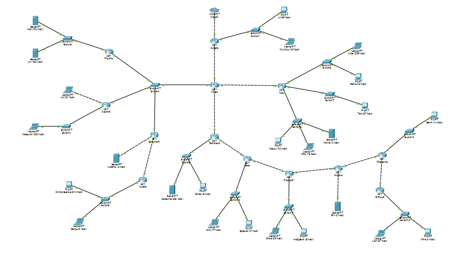
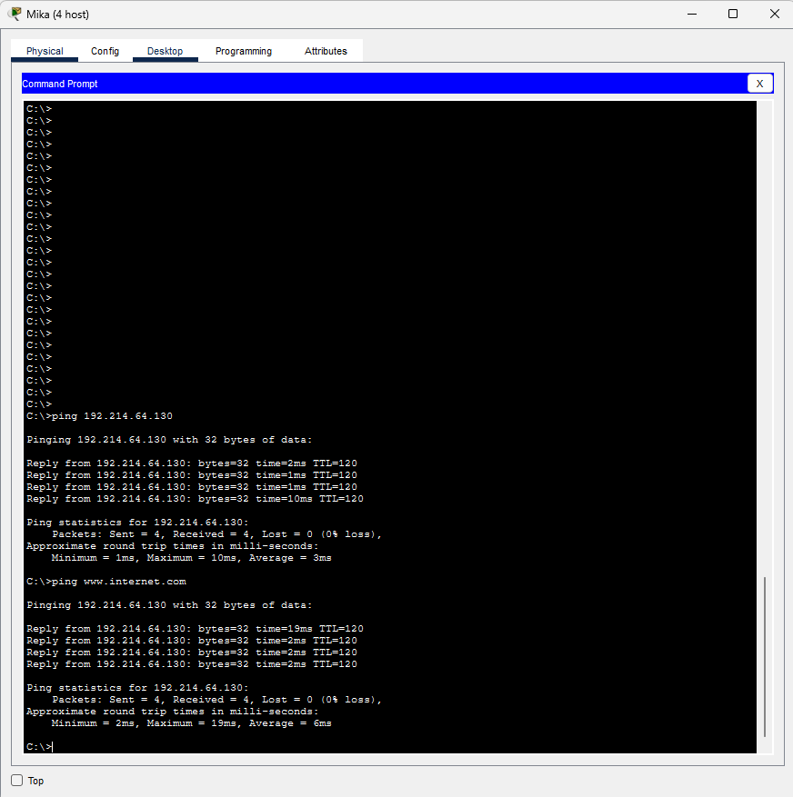
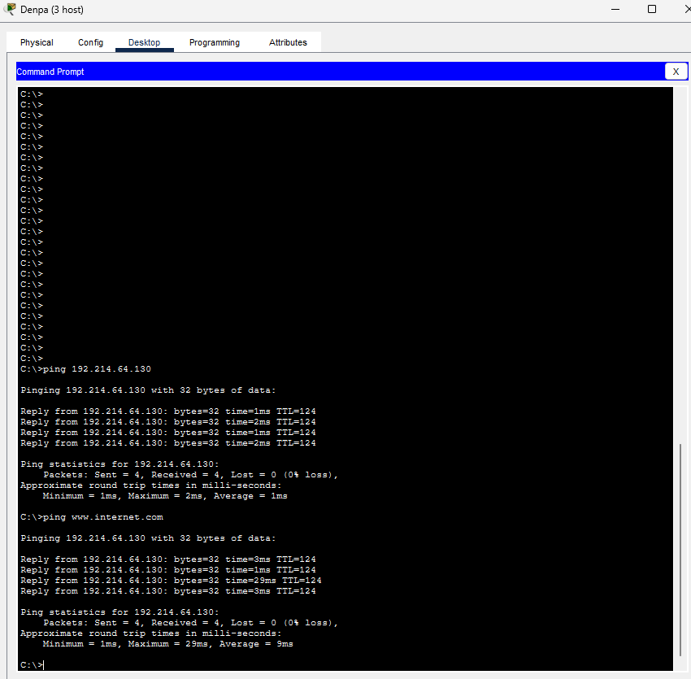
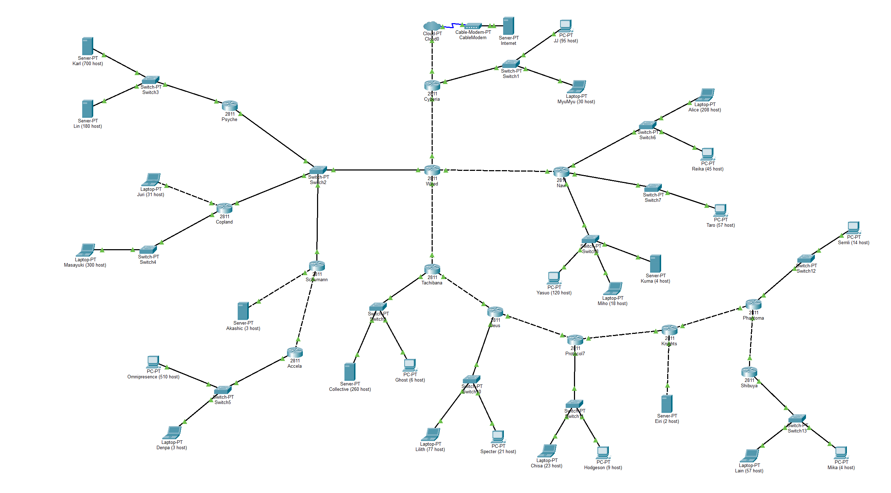

# Jarkom-Modul-4-2026-K-06

### 1 - Perancangan Subnet dengan CIDR (Cisco Packet Tracer)


#### Tujuan

Alamat yang digunakan berada di dalam blok `192.214.0.0/17`. Subnet digabungkan secara bertahap dari tahap B sampai J. Setiap hasil merge hanya memiliki dua anak, dan seluruh hasil merge memiliki nama yang unik. Root pohon adalah `J1`, yaitu `192.214.0.0/17`.

#### Tahapan Penggabungan

| Tahap | Hasil | Dua subnet yang digabung | CIDR hasil |
|---|---|---|---|
| B | B1 | A24 + A25 | `192.214.0.0/25` |
| B | B2 | A8 + A9 | `192.214.48.0/21` |
| B | B3 | A5 + A6 | `192.214.40.0/22` |
| B | B4 | A10 + A12 | `192.214.18.0/25` |
| B | B5 | A11 + A13 | `192.214.16.0/23` |
| B | B6 | A22 + A23 | `192.214.0.128/26` |
| B | B7 | A20 + A21 | `192.214.1.0/28` |
| B | B8 | A3 + A4 | `192.214.32.0/21` |
| B | B9 | A18 + A19 | `192.214.2.0/25` |
| B | B10 | A16 + A17 | `192.214.4.0/24` |
| B | B11 | A14 + A15 | `192.214.8.0/22` |
| C | C1 | B6 + B1 | `192.214.0.0/24` |
| C | C2 | B8 + B3 | `192.214.32.0/20` |
| C | C3 | A7 + B2 | `192.214.48.0/20` |
| C | C4 | B4 + B5 | `192.214.16.0/22` |
| D | D1 | B7 + C1 | `192.214.0.0/23` |
| D | D2 | A2 + C4 | `192.214.16.0/21` |
| D | D3 | C2 + C3 | `192.214.32.0/19` |
| E | E1 | B9 + D1 | `192.214.0.0/22` |
| F | F1 | B10 + E1 | `192.214.0.0/21` |
| G | G1 | B11 + F1 | `192.214.0.0/20` |
| H | H1 | D2 + G1 | `192.214.0.0/19` |
| I | I1 | H1 + D3 | `192.214.0.0/18` |
| J | J1 | A1 + I1 | `192.214.0.0/17` |


#### Tabel Alokasi Subnet

| Subnet | Network ID | Netmask | Broadcast | Rentang IP host |
|---|---|---|---|---|
| A1 | `192.214.64.0` | `255.255.255.128 (/25)` | `192.214.64.127` | `192.214.64.1–192.214.64.126` |
| A2 | `192.214.20.0` | `255.255.255.252 (/30)` | `192.214.20.3` | `192.214.20.1–192.214.20.2` |
| A3 | `192.214.36.0` | `255.255.255.248 (/29)` | `192.214.36.7` | `192.214.36.1–192.214.36.6` |
| A4 | `192.214.32.0` | `255.255.252.0 (/22)` | `192.214.35.255` | `192.214.32.1–192.214.35.254` |
| A5 | `192.214.42.0` | `255.255.255.192 (/26)` | `192.214.42.63` | `192.214.42.1–192.214.42.62` |
| A6 | `192.214.40.0` | `255.255.254.0 (/23)` | `192.214.41.255` | `192.214.40.1–192.214.41.254` |
| A7 | `192.214.56.0` | `255.255.255.248 (/29)` | `192.214.56.7` | `192.214.56.1–192.214.56.6` |
| A8 | `192.214.52.0` | `255.255.255.252 (/30)` | `192.214.52.3` | `192.214.52.1–192.214.52.2` |
| A9 | `192.214.48.0` | `255.255.252.0 (/22)` | `192.214.51.255` | `192.214.48.1–192.214.51.254` |
| A10 | `192.214.18.64` | `255.255.255.252 (/30)` | `192.214.18.67` | `192.214.18.65–192.214.18.66` |
| A11 | `192.214.16.0` | `255.255.255.0 (/24)` | `192.214.16.255` | `192.214.16.1–192.214.16.254` |
| A12 | `192.214.18.0` | `255.255.255.192 (/26)` | `192.214.18.63` | `192.214.18.1–192.214.18.62` |
| A13 | `192.214.17.0` | `255.255.255.0 (/24)` | `192.214.17.255` | `192.214.17.1–192.214.17.254` |
| A14 | `192.214.10.0` | `255.255.255.252 (/30)` | `192.214.10.3` | `192.214.10.1–192.214.10.2` |
| A15 | `192.214.8.0` | `255.255.254.0 (/23)` | `192.214.9.255` | `192.214.8.1–192.214.9.254` |
| A16 | `192.214.4.128` | `255.255.255.252 (/30)` | `192.214.4.131` | `192.214.4.129–192.214.4.130` |
| A17 | `192.214.4.0` | `255.255.255.128 (/25)` | `192.214.4.127` | `192.214.4.1–192.214.4.126` |
| A18 | `192.214.2.64` | `255.255.255.252 (/30)` | `192.214.2.67` | `192.214.2.65–192.214.2.66` |
| A19 | `192.214.2.0` | `255.255.255.192 (/26)` | `192.214.2.63` | `192.214.2.1–192.214.2.62` |
| A20 | `192.214.1.8` | `255.255.255.252 (/30)` | `192.214.1.11` | `192.214.1.9–192.214.1.10` |
| A21 | `192.214.1.0` | `255.255.255.248 (/29)` | `192.214.1.7` | `192.214.1.1–192.214.1.6` |
| A22 | `192.214.0.160` | `255.255.255.252 (/30)` | `192.214.0.163` | `192.214.0.161–192.214.0.162` |
| A23 | `192.214.0.128` | `255.255.255.224 (/27)` | `192.214.0.159` | `192.214.0.129–192.214.0.158` |
| A24 | `192.214.0.64` | `255.255.255.252 (/30)` | `192.214.0.67` | `192.214.0.65–192.214.0.66` |
| A25 | `192.214.0.0` | `255.255.255.192 (/26)` | `192.214.0.63` | `192.214.0.1–192.214.0.62` |

Alamat pada tabel berada dalam blok root `192.214.0.0/17`. Untuk subnet transit `/30`, dua alamat host digunakan oleh kedua ujung link. 

#### Routing pada Cisco Packet Tracer

Routing pada topologi CPT ini menggunakan **static routing** di seluruh 13 router (Cyberia, Wired, Psyche, Copland, Schumann, Accela, Navi, Tachibana, Deus, Protocol7, Knights, Phantoma, Shibuya). Tidak ada protokol routing dinamis (RIP/OSPF/EIGRP); setiap entri ditulis manual dengan perintah `ip route`.

Strategi routing memanfaatkan hasil penggabungan CIDR tahap B–J: setiap router "cabang" cukup mendaftarkan blok CIDR hasil merge sebagai route menuju seluruh subnet anaknya, sehingga jumlah entri static tetap sedikit. Terdapat tiga pola:

1. **Router pusat (Wired)**: backbone yang terhubung ke semua cabang utama. Ia tidak memakai default route, melainkan entri summary statis untuk setiap cabang.
2. **Router perantara**: memakai route summary ke bawah (menuju cabangnya) dan default route ke atas (menuju Wired).
3. **Router ujung (daun)**: cukup memakai default route yang menunjuk ke router induknya.

###### Topologi routing



###### Tabel konfigurasi routing per-router

| Router | Peran | Static route (destination `via` next-hop) | Default route |
|---|---|---|---|
| Wired | Backbone pusat | `192.214.0.0/20` via Tachibana (`192.214.10.2`); `192.214.16.0/22` via Navi (`192.214.18.65`); `192.214.32.0/22` via Psyche (`192.214.36.2`); `192.214.40.0/23` via Copland (`192.214.36.3`); `192.214.48.0/20` via Schumann (`192.214.36.4`); `192.214.64.0/25` via Cyberia (`192.214.20.1`) | - |
| Cyberia | Gerbang internet | `192.214.0.0/18` via Wired (`192.214.20.2`) | `0.0.0.0/0` via Cloud0 (`192.214.64.130`) |
| Tachibana | Perantara cabang | `192.214.0.0/18` via Wired (`192.214.10.1`); `192.214.0.0/21` via Deus (`192.214.4.130`); `192.214.64.0/25` via Wired (`192.214.10.1`) | tidak ada |
| Deus | Perantara cabang | `192.214.0.0/22` via Protocol7 (`192.214.2.66`) | via Tachibana (`192.214.4.129`) |
| Protocol7 | Perantara cabang | `192.214.0.0/23` via Knights (`192.214.1.10`) | via Deus (`192.214.2.65`) |
| Knights | Perantara cabang | `192.214.0.0/24` via Phantoma (`192.214.0.162`) | via Protocol7 (`192.214.1.9`) |
| Phantoma | Perantara cabang | `192.214.0.0/25` via Shibuya (`192.214.0.66`) | via Knights (`192.214.0.161`) |
| Navi | Perantara cabang | `192.214.0.0/18` via Wired (`192.214.18.66`); `192.214.64.0/25` via Wired (`192.214.18.66`) | tidak ada |
| Schumann | Perantara cabang | `192.214.48.0/21` via Accela (`192.214.52.2`) | via Wired (`192.214.36.1`) |
| Psyche | Router daun | tidak ada | via Wired (`192.214.36.1`) |
| Copland | Router daun | tidak ada | via Wired (`192.214.36.1`) |
| Accela | Router daun | tidak ada | via Schumann (`192.214.52.1`) |
| Shibuya | Router daun | tidak ada | via Phantoma (`192.214.0.65`) |

###### Contoh konfigurasi (Wired sebagai backbone)

```
Wired(config)# ip route 192.214.0.0 255.255.240.0 192.214.10.2
Wired(config)# ip route 192.214.16.0 255.255.252.0 192.214.18.65
Wired(config)# ip route 192.214.32.0 255.255.252.0 192.214.36.2
Wired(config)# ip route 192.214.40.0 255.255.254.0 192.214.36.3
Wired(config)# ip route 192.214.48.0 255.255.240.0 192.214.36.4
Wired(config)# ip route 192.214.64.0 255.255.255.128 192.214.20.1
```

Catatan: next-hop pada tabel di atas mengikuti pembagian alamat subnet transit `/30`; misalnya pada A2 (`20.0/30`), Cyberia = `192.214.20.1` dan Wired = `192.214.20.2`.


### 2 - Perancangan Subnet dengan VLSM (GNS 3)

#### Tujuan

#### Topologi Jaringan

#### Perhitungan dan Pembagian Subnet

#### Tabel Alokasi Alamat IP

#### Konfigurasi Perangkat

#### Pengujian Konektivitas

## Revisi

### 1 - Menghubungkan Seluruh Host ke Internet (Cisco Packet Tracer)

#### Masalah

Pada kondisi awal, Cloud0 hanya tersambung satu arah ke Cyberia tanpa ada perangkat lain di baliknya, sehingga default route Cyberia (`0.0.0.0/0 via 192.214.64.130`) menunjuk ke jaringan yang tidak berisi apa pun. Akibatnya tidak ada satu pun host yang dapat mengakses internet.

#### Pendekatan

```
<host LAN> ... <Wired> ── <Cyberia> ── (A26: 64.128/30) ── <Cloud0> ── coax ── <CableModem> ── <Server "Internet">
```
Packet Tracer tidak memiliki internet bawaan, dan Cloud0 hanyalah kotak pasif penghubung media (tidak punya IP stack maupun layanan), sehingga sisi internet harus diwakili perangkat yang bisa merespons (server). Port Ethernet6 Cloud0 terlanjur dipakai Cyberia dan tidak ada port Ethernet kosong lainnya, sehingga jalur masuknya memakai port Coaxial melalui Cable Modem.


#### Konfigurasi yang Ditambahkan

| Perangkat | Konfigurasi |
|---|---|
| CableModem (`Cable-Modem-PT`, baru) | Tanpa konfigurasi, cukup menjembatani port coaxial dan ethernet |
| Internet (`Server-PT`, baru) | IP `192.214.64.130/30`, gateway `192.214.64.129`; layanan HTTP (`index.html`) dan DNS dengan record A `www.internet.com → 192.214.64.130` |
| Cloud0 | Dipasangkan port `Coaxial7 ↔ Ethernet6` pada konfigurasi antarmuka Cloud0 (perangkat Cloud), plus mode emulasi internet pada Ethernet6 |
| Wired | `ip route 192.214.64.128 255.255.255.252 192.214.20.1` |
| Navi | `ip route 192.214.64.128 255.255.255.252 192.214.18.66` |
| Tachibana | `ip route 192.214.64.128 255.255.255.252 192.214.10.1` |
| 25 host akhir | DNS server = `192.214.64.130` (alamat IP, subnet mask, dan default gateway tidak diubah) |

Catatan: alamat server `192.214.64.130` dipilih karena persis merupakan next-hop default route Cyberia yang sudah ada sejak awal, sehingga konfigurasi Cyberia dan seluruh router lain tidak perlu diubah. Tiga static route yang ditambahkan hanyalah penjangkauan subnet A26 saja (`192.214.64.128/30`), karena prefix tersebut terletak di luar ringkasan (summary) `192.214.64.0/25` yang tadinya ada di tabel Wired, dan Navi/Tachibana memang tidak memiliki default route pada desain awalnya.

#### Alur Trafik

- **Ke arah internet:** host → default gateway router cabang → … → Wired → Cyberia → default route via `192.214.64.130` → sampai ke server Internet.
- **Balik ke host:** server Internet → gateway `192.214.64.129` (Cyberia) → static route summary cabang yang sudah ada → host.

#### Pengujian Konektivitas





#### Dokumentasi



### 2 - (Revisi berikutnya)

