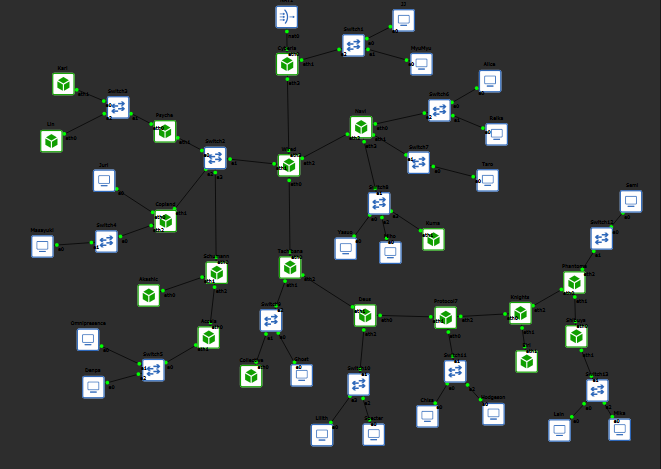
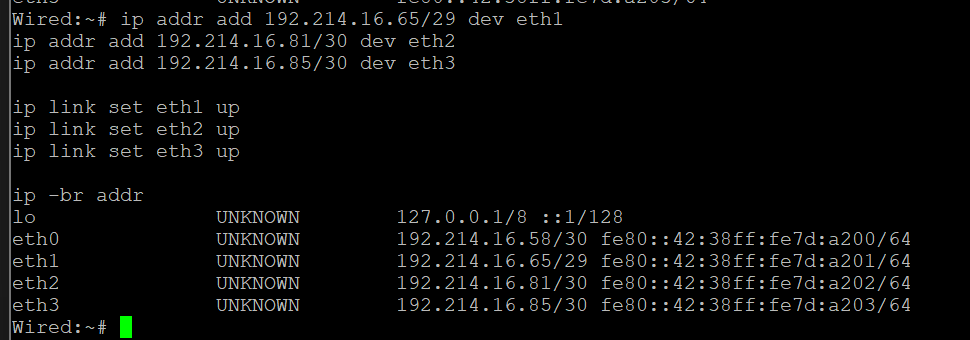
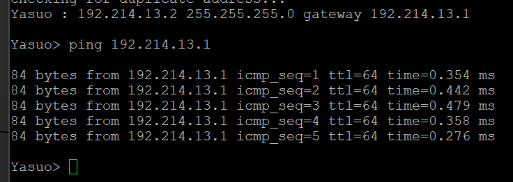
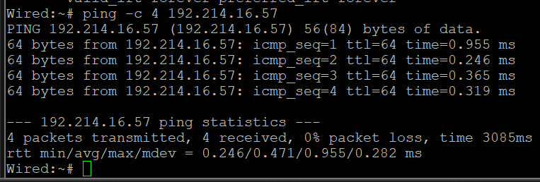

#### Revisi

### 2 - Perancangan Subnet dengan VLSM (GNS3)

##### Tujuan

Melakukan perancangan dan implementasi pembagian alamat IP menggunakan metode Variable Length Subnet Mask (VLSM) pada topologi jaringan di GNS3.

Pembagian subnet dilakukan berdasarkan kebutuhan jumlah host pada masing-masing jaringan. Setiap subnet memperoleh prefix yang sesuai agar penggunaan alamat IP lebih efisien.

Implementasi meliputi:
- Menentukan Network ID dan prefix setiap subnet.
- Menentukan subnet mask, broadcast address, dan rentang IP host.
- Mengonfigurasi alamat IP pada interface router.
- Mengonfigurasi alamat IP dan default gateway pada end device.
- Melakukan pengujian konektivitas menggunakan perintah `ping`.

##### Topologi Jaringan

Topologi jaringan terdiri dari beberapa router, switch, dan end device yang saling terhubung. Router digunakan untuk menghubungkan beberapa subnet, sedangkan switch menghubungkan perangkat dalam satu LAN.

Topologi yang digunakan mengikuti rancangan jaringan pada modul praktikum Jarkom Modul 4.

**Dokumentasi Topologi GNS3**



##### Perhitungan dan Pembagian Subnet

Perhitungan VLSM menggunakan blok jaringan induk `192.214.0.0/19`.

Penentuan prefix dilakukan berdasarkan kebutuhan host setiap subnet dengan rumus:

`2^h - 2 >= jumlah host yang dibutuhkan`

Keterangan:
- `h` merupakan jumlah bit host.
- Prefix diperoleh dari `32 - h`.
- Dua alamat IP digunakan untuk Network ID dan Broadcast Address.

Setelah prefix ditentukan, subnet diurutkan berdasarkan kebutuhan host dari jumlah terbesar ke terkecil. Alokasi alamat dilakukan secara berurutan dengan memperhatikan ukuran blok setiap subnet.

##### Tabel Alokasi Alamat IP

| Subnet | Network ID | Prefix | Subnet Mask | Broadcast | Rentang IP Host |
|---|---|---|---|---|---|
| A1 | `192.214.14.0` | /25 | `255.255.255.128` | `192.214.14.127` | `192.214.14.1–192.214.14.126` |
| A2 | `192.214.16.56` | /30 | `255.255.255.252` | `192.214.16.59` | `192.214.16.57–192.214.16.58` |
| A3 | `192.214.16.32` | /29 | `255.255.255.248` | `192.214.16.39` | `192.214.16.33–192.214.16.38` |
| A4 | `192.214.0.0` | /22 | `255.255.252.0` | `192.214.3.255` | `192.214.0.1–192.214.3.254` |
| A5 | `192.214.15.192` | /26 | `255.255.255.192` | `192.214.15.255` | `192.214.15.193–192.214.15.254` |
| A6 | `192.214.8.0` | /23 | `255.255.254.0` | `192.214.9.255` | `192.214.8.1–192.214.9.254` |
| A7 | `192.214.16.40` | /29 | `255.255.255.248` | `192.214.16.47` | `192.214.16.41–192.214.16.46` |
| A8 | `192.214.16.60` | /30 | `255.255.255.252` | `192.214.16.63` | `192.214.16.61–192.214.16.62` |
| A9 | `192.214.4.0` | /22 | `255.255.252.0` | `192.214.7.255` | `192.214.4.1–192.214.7.254` |
| A10 | `192.214.16.64` | /30 | `255.255.255.252` | `192.214.16.67` | `192.214.16.65–192.214.16.66` |
| A11 | `192.214.12.0` | /24 | `255.255.255.0` | `192.214.12.255` | `192.214.12.1–192.214.12.254` |
| A12 | `192.214.15.64` | /26 | `255.255.255.192` | `192.214.15.127` | `192.214.15.65–192.214.15.126` |
| A13 | `192.214.13.0` | /24 | `255.255.255.0` | `192.214.13.255` | `192.214.13.1–192.214.13.254` |
| A14 | `192.214.16.68` | /30 | `255.255.255.252` | `192.214.16.71` | `192.214.16.69–192.214.16.70` |
| A15 | `192.214.10.0` | /23 | `255.255.254.0` | `192.214.11.255` | `192.214.10.1–192.214.11.254` |
| A16 | `192.214.16.72` | /30 | `255.255.255.252` | `192.214.16.75` | `192.214.16.73–192.214.16.74` |
| A17 | `192.214.14.128` | /25 | `255.255.255.128` | `192.214.14.255` | `192.214.14.129–192.214.14.254` |
| A18 | `192.214.16.76` | /30 | `255.255.255.252` | `192.214.16.79` | `192.214.16.77–192.214.16.78` |
| A19 | `192.214.15.128` | /26 | `255.255.255.192` | `192.214.15.191` | `192.214.15.129–192.214.15.190` |
| A20 | `192.214.16.80` | /30 | `255.255.255.252` | `192.214.16.83` | `192.214.16.81–192.214.16.82` |
| A21 | `192.214.16.48` | /29 | `255.255.255.248` | `192.214.16.55` | `192.214.16.49–192.214.16.54` |
| A22 | `192.214.16.84` | /30 | `255.255.255.252` | `192.214.16.87` | `192.214.16.85–192.214.16.86` |
| A23 | `192.214.16.0` | /27 | `255.255.255.224` | `192.214.16.31` | `192.214.16.1–192.214.16.30` |
| A24 | `192.214.16.88` | /30 | `255.255.255.252` | `192.214.16.91` | `192.214.16.89–192.214.16.90` |
| A25 | `192.214.15.0` | /26 | `255.255.255.192` | `192.214.15.63` | `192.214.15.1–192.214.15.62` |

##### Konfigurasi Perangkat

Implementasi IP addressing dilakukan pada router dan end device menggunakan console masing-masing node di GNS3.

Pada perangkat berbasis Alpine Linux, konfigurasi alamat IP dilakukan menggunakan perintah `ip addr`. Sementara itu, end device berbasis VPCS menggunakan perintah `ip` dengan format alamat IP, subnet mask, dan default gateway.

Contoh konfigurasi interface pada Alpine Linux:

```bash
ip addr replace 192.214.0.2/22 dev eth0
ip link set eth0 up
```

Contoh konfigurasi alamat IP pada VPCS:

```bash
ip 192.214.14.2 255.255.255.128 192.214.14.1
```

Berikut beberapa konfigurasi perangkat yang telah diterapkan dan terdokumentasi:

| Perangkat | Interface | IP Address |
|---|---|---|
| Cyberia | eth1 | `192.214.14.1/25` |
| Cyberia | eth3 | `192.214.16.57/30` |
| Wired | eth0 | `192.214.16.69/30` |
| Wired | eth1 | `192.214.16.33/29` |
| Wired | eth2 | `192.214.16.65/30` |
| Wired | eth3 | `192.214.16.58/30` |
| Copland | eth0 | `192.214.16.35/29` |
| Copland | eth1 | `192.214.15.193/26` |
| Copland | eth2 | `192.214.8.1/23` |
| Navi | eth0 | `192.214.12.1/24` |
| Navi | eth1 | `192.214.15.65/26` |
| Navi | eth2 | `192.214.16.66/30` |
| Navi | eth3 | `192.214.13.1/24` |
| Tachibana | eth0 | `192.214.16.70/30` |
| Tachibana | eth1 | `192.214.10.1/23` |
| Tachibana | eth2 | `192.214.16.73/30` |
| Deus | eth0 | `192.214.16.77/30` |
| Deus | eth1 | `192.214.16.74/30` |
| Deus | eth2 | `192.214.14.129/25` |
| Protocol7 | eth0 | `192.214.15.129/26` |
| Protocol7 | eth1 | `192.214.16.78/30` |
| Protocol7 | eth2 | `192.214.16.81/30` |
| Knights | eth0 | `192.214.16.82/30` |
| Knights | eth1 | `192.214.16.49/29` |
| Knights | eth2 | `192.214.16.85/30` |
| Phantoma | eth0 | `192.214.16.86/30` |
| Phantoma | eth1 | `192.214.16.89/30` |
| Phantoma | eth2 | `192.214.16.1/27` |
| Shibuya | eth0 | `192.214.16.90/30` |
| Shibuya | eth1 | `192.214.15.1/26` |

Beberapa end device juga telah dikonfigurasi, di antaranya:

| End Device | IP Address | Keterangan |
|---|---|---|
| JJ | `192.214.14.2/25` | Gateway `192.214.14.1` |
| Karl | `192.214.0.2/22` | Terhubung ke subnet A4 |
| Lin | `192.214.0.3/22` | Terhubung ke subnet A4 |
| Akashic | `192.214.16.42/29` | Terhubung ke subnet A7 |
| Collective | `192.214.10.2/23` | Terhubung ke subnet A15 |
| Eiri | `192.214.16.50/29` | Terhubung ke subnet A21 |
| Yasuo | `192.214.13.2/24` | Terhubung ke Switch8 |
| Miho | `192.214.13.3/24` | Terhubung ke Switch8 |
| Kuma | `192.214.13.4/24` | Terhubung melalui interface eth1 |

**Dokumentasi Konfigurasi Perangkat**





##### Pengujian Konektivitas

Pengujian konektivitas dilakukan menggunakan perintah `ping` untuk memastikan perangkat dapat berkomunikasi dengan perangkat lain pada jaringan yang sama.

Beberapa pengujian yang telah dilakukan dan menunjukkan hasil berhasil adalah sebagai berikut:

| Perangkat Sumber | Perangkat Tujuan | IP Tujuan | Hasil |
|---|---|---|---|
| JJ | Gateway Cyberia | `192.214.14.1` | Berhasil |
| Wired | Tachibana | `192.214.16.70` | Berhasil |
| Wired | Schumann | `192.214.16.34` | Berhasil |
| Wired | Navi | `192.214.16.66` | Berhasil |
| Wired | Cyberia | `192.214.16.57` | Berhasil |
| Tachibana | Deus | `192.214.16.74` | Berhasil |
| Deus | Protocol7 | `192.214.16.78` | Berhasil |
| Protocol7 | Knights | `192.214.16.82` | Berhasil |
| Knights | Phantoma | `192.214.16.86` | Berhasil |
| Knights | Eiri | `192.214.16.50` | Berhasil |
| Phantoma | Shibuya | `192.214.16.90` | Berhasil |
| Navi | Yasuo | `192.214.13.2` | Berhasil |
| Kuma | Navi | `192.214.13.1` | Berhasil |

Hasil pengujian menunjukkan bahwa beberapa koneksi antarperangkat telah berhasil, ditandai dengan diterimanya paket ICMP tanpa packet loss pada pengujian yang berhasil.

**Dokumentasi Pengujian Konektivitas**




##### Status Pengerjaan dan Kendala

Pada tahap pengerjaan ini, konfigurasi IP addressing telah diterapkan pada sejumlah router dan end device. Pengujian konektivitas juga telah dilakukan pada beberapa jalur komunikasi dan menunjukkan hasil berhasil.

Namun, keseluruhan implementasi jaringan belum selesai. Tahapan konfigurasi dan pengujian routing antarjaringan masih perlu dilanjutkan.

Pada saat pengerjaan, koneksi ke remote GNS3 server mengalami gangguan. GNS3 menampilkan pesan `Websocket notification stream error` dan `502 Bad Gateway`, sehingga project tidak dapat diakses secara normal untuk sementara waktu.

Kondisi tersebut menyebabkan proses konfigurasi dan pengujian lanjutan harus ditunda hingga koneksi server kembali normal.

Tahapan yang masih perlu diselesaikan:
- Memastikan seluruh interface router dan end device telah memiliki alamat IP yang sesuai.
- Memeriksa dan mengaktifkan IP forwarding pada router.
- Melakukan konfigurasi routing antarjaringan.
- Melakukan pengujian konektivitas lintas subnet.
- Melakukan verifikasi akhir terhadap keseluruhan topologi.
